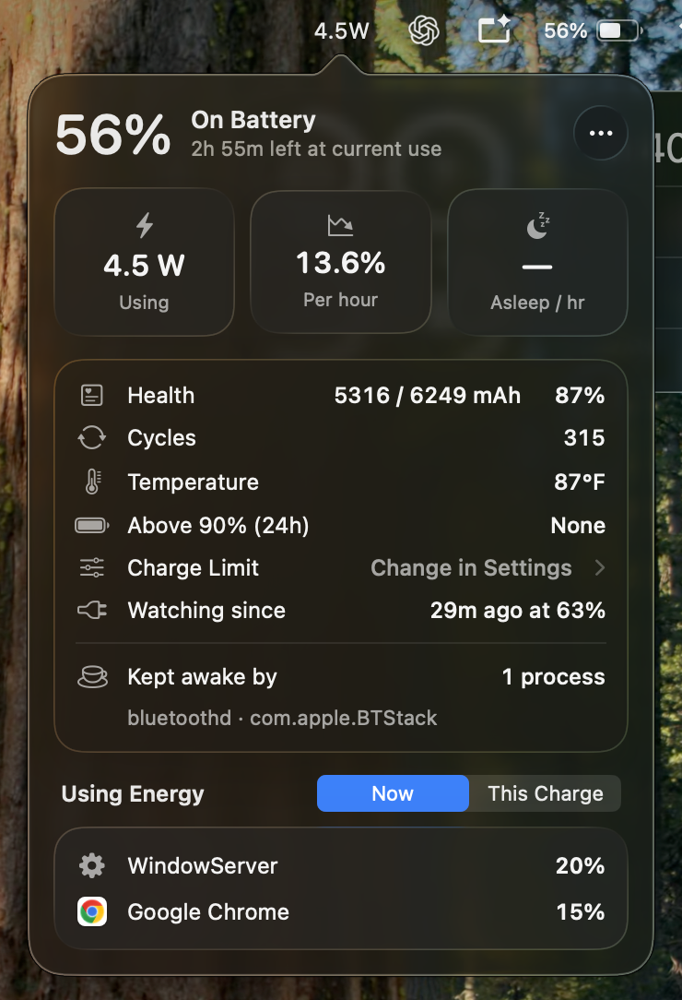

# BatteryWatch

A small menu bar app for MacBooks that shows how much power your Mac is using right now, what is using it, and how your battery's health is holding up. Built in Swift with no dependencies. It only reads system data and never changes system settings.

## Screenshots

<p align="center">
  <br>
  
  
</p>

## Who can use it

| Requirement                                                    | Why                                                                                                                                                                 |
| -------------------------------------------------------------- | ------------------------------------------------------------------------------------------------------------------------------------------------------------------- |
| **A MacBook** (any Mac with a battery)                         | Desktop Macs have no battery to read, so the app has nothing to show.                                                                                               |
| **Apple Silicon** (M1 or newer)                                | `build.sh` compiles for `arm64` only. For an Intel MacBook, change `-target arm64-apple-macos13` to `-target x86_64-apple-macos13` in `build.sh`. This is untested. |
| **macOS 13 Ventura or newer** to run it                        | The oldest version the app supports. On macOS 26 Tahoe and newer, the popover uses Liquid Glass. On older versions it uses plain cards instead.                     |
| **macOS 26.4 or newer** for the charge limit                   | Apple added its built-in charge limit in 26.4. On older versions, the Charge Limit button opens Battery settings, but there's no slider there.                      |
| **Xcode Command Line Tools with the macOS 26 SDK** to build it | The code uses the macOS 26 Liquid Glass API. A full Xcode install isn't needed.                                                                                     |

## Features

### In the menu bar

- **On battery:** shows the current power draw in watts, averaged over 3 minutes, e.g. `8.4W`. A single number tells you whether something is draining the battery: light use is usually 3–8 W.
- **Plugged in:** shows ⚡︎ (charging) or 🔌 (not charging) and the charge level.
- **⚠︎** appears in front of the number when a process has used a lot of CPU for 5 minutes or more.

Click the menu bar item to open the popover.

### Header

- Charge level, the power state, and **time remaining** based on your actual use over the last 10 minutes. macOS's own estimate jumps around much more.

### Three tiles

| Tile                 | What it shows                                                                              | Why it's useful                                                                                     |
| -------------------- | ------------------------------------------------------------------------------------------ | --------------------------------------------------------------------------------------------------- |
| **Using / Charging** | Watts in or out of the battery                                                             | Spot heavy use straight away. Turns orange above 15 W.                                              |
| **Per hour**         | Battery % used per hour over the last hour, measured from the battery's real charge in mAh | A more honest drain figure than the % shown in the menu bar.                                        |
| **Asleep / hr**      | % lost per hour during the last sleep on battery                                           | A healthy Mac loses under ~1%/hr while asleep. A higher number means something is keeping it awake. |

### Warnings card

This card only appears when something is wrong. Each warning comes with a one-line tip.

- **A process stuck at high CPU**, with advice for common causes such as Bluetooth (`BTLEServer`), Spotlight indexing, Photos analysis, Chrome tabs and Time Machine.
- **No restart in more than 7 days.** Long uptimes collect stuck background processes.
- **High power draw:** more than 15 W averaged over 10 minutes.
- **Battery is hot:** above 40°C, or 35°C or more while charging. Heat while charging is the fastest cause of battery wear.
- **Held above 90% for 8+ hours in the last 24h.** Sitting near full is the other main cause of wear. The tip points you to the charge limit.
- **Capacity below 80%:** time to consider a battery service.
- **Fast drain while asleep:** more than 1.5%/hr.

### Details card

| Row                                                                  | Why it's useful                                                                                                                                                  |
| -------------------------------------------------------------------- | ---------------------------------------------------------------------------------------------------------------------------------------------------------------- |
| **Health:** current full capacity vs. design capacity in mAh, plus % | Matches the "Maximum Capacity" figure in System Settings.                                                                                                        |
| **Cycles**                                                           | Apple rates most MacBook batteries for 1000 cycles.                                                                                                              |
| **Temperature**                                                      | Turns orange when it's high enough to wear the battery.                                                                                                          |
| **Above 90% (24h)**                                                  | How long the Mac sat plugged in at 90% or more today. Shows whether a charge limit would help you.                                                               |
| **Charge Limit → Change in Settings**                                | Opens the macOS Battery Health sheet with the charge limit slider in one click. See [Why the charge limit opens Settings](#why-the-charge-limit-opens-settings). |
| **Unplugged / Last sleep**                                           | When you unplugged and at what %, and how much was lost during the last sleep.                                                                                   |
| **Kept awake by**                                                    | Processes currently preventing sleep, from `pmset -g assertions`.                                                                                                |

### Using Energy

- **Now:** the apps using the most CPU over the last minute, with their icons. Helper processes are counted toward their app, so all of Chrome's helpers show up as one "Google Chrome" row.
- **This Charge:** total CPU time per app since you last unplugged. Shows what used your battery over the whole session.

### Notifications

You get a macOS notification when:

- a process stays above 50% CPU for 5 minutes or more,
- power draw averages more than 20 W over 10 minutes on battery,
- the battery gets hot (35°C or more while charging, or 40°C or more at any time),
- the Mac lost more than 1.5%/hr during a sleep longer than 30 minutes.

Each type of alert is sent at most once every 2 hours.

### History log

Every sample (once a minute) is saved to `~/Library/Application Support/BatteryWatch/`:

- `samples.csv`: time, %, power state, watts, voltage, current, temperature, health, cycles and the top 3 processes. You can open it in Numbers or Excel to look into a drain after it happened.
- `events.log`: unplug and plug-in, sleep and wake with % lost, and every alert sent.

Entries older than **30 days** are deleted automatically, once at launch and then once a day. Open the folder from the **⋯** menu → **Open History Folder**.

### ⋯ menu

- Open Activity Monitor
- Open History Folder
- **Keep History (30 days)**: on by default. Turn it off to stop writing anything to disk. The **Above 90% (24h)** row and its warning disappear while it's off, because they're calculated from the log.
- **Launch at Login**
- Quit

## Why the charge limit opens Settings

macOS only accepts charge limit changes from Apple's own apps. Third-party tools like AlDente get around this with a helper program that runs with administrator rights and writes undocumented values to the Mac's power controller. That approach can break with firmware updates, and it needs root access. BatteryWatch avoids it on purpose: the button takes you straight to Apple's own slider, and the setting you choose there stays in effect through sleep and restarts.

## Privacy: what it reads and what it keeps

BatteryWatch makes **no network connections**. Nothing leaves your Mac, and there are no analytics or update checks. It runs as your normal user account, not as an administrator. It doesn't ask for any macOS permissions, such as Accessibility, Screen Recording or Full Disk Access. All the same, it reads more than you might expect, and **it keeps a log of how you use your Mac**, so here's what's involved.

### Where the data comes from

| Source                                                                                      | What the app uses                                                            | What else is there (read but not used or saved)                                                                                                                                                                                            |
| ------------------------------------------------------------------------------------------- | ---------------------------------------------------------------------------- | ------------------------------------------------------------------------------------------------------------------------------------------------------------------------------------------------------------------------------------------ |
| **Battery controller** (`AppleSmartBattery` in the IORegistry, the same data `ioreg` shows) | Charge, voltage, current, temperature, capacity, cycle count, charging state | The battery's **serial number**, manufacture date, lifetime min/max temperatures and other gauge data. The app loads the whole record, uses only the fields on the left, and stores none of the rest.                                      |
| **`system_profiler SPPowerDataType`**, about once an hour                                   | The "Maximum Capacity" %                                                     | The battery serial number, the charger's details, and your power settings. Only the one number is read.                                                                                                                                    |
| **`ps -axo pid,time,comm`**, every minute                                                   | CPU time per process, to rank apps by energy use                             | The full list of every running process on the Mac, **including other users' processes and system services**, with their install paths. Any program on macOS can see this list.                                                             |
| **`pmset -g assertions`**, when you open the popover                                        | What's preventing sleep                                                      | The reasons apps give for keeping the Mac awake. These can reveal what you're doing, e.g. "Playing audio", "WebRTC has active PeerConnections" (a video call) or a download in progress. They're shown in the popover but **never saved**. |

### What gets saved to disk

Everything is stored in `~/Library/Application Support/BatteryWatch/`:

- **`samples.csv`**, one row per minute while the Mac is awake: battery stats plus the **names of the top 3 apps or processes using CPU**. Over time, this becomes a **minute-by-minute record of which apps you used and when**, e.g. that Spotify or a particular game was running at 2 a.m.
- **`events.log`**: every sleep, wake, unplug and plug-in with timestamps, so it's effectively a **timeline of when you used and charged your laptop**. Alerts are logged too, with the name of the app that caused them.
- **The logs cover the last 30 days.** Older entries are deleted automatically. A full month is a few MB at most.

What that means:

- Only your user account can read the logs. Other accounts on the Mac can't, because `~/Library` is private to you. An administrator, or anything running as you, can.
- **Time Machine backs them up** like the rest of your Library folder. Exclude the folder in System Settings → General → Time Machine → Options if you don't want that.
- If you share the log, for example to get help with a battery drain, remember that it shows your app usage, not just battery data.
- **To stop logging**, turn off **⋯ → Keep History**. Nothing more is written, but turning it off doesn't delete what's already there. Existing entries are still cleared once they're 30 days old.
- **To clear the history now**, quit the app and delete the folder: `rm -rf ~/Library/Application\ Support/BatteryWatch`.

### Other places your information ends up

- **Notifications** go through AppleScript, so they appear as coming from **Script Editor**. They include app names, e.g. "Spotify is draining battery", and stay in Notification Center like any other notification. They may also appear on your lock screen.
- **Launch at Login** creates `~/Library/LaunchAgents/com.local.batterywatch.plist`, which contains the app's path, including your macOS username.
- **The built app** in `build/` contains the full path of the folder it was built in, which includes your username. The repository's `.gitignore` keeps it out of git, so it doesn't reach GitHub.

## Installing on another Mac

1. **Install the Command Line Tools** (skip this if Xcode is already installed):

   ```sh
   xcode-select --install
   ```

   Check that the build tools are ready. The second command should print `26.0` or higher:

   ```sh
   swiftc --version
   xcrun --show-sdk-version
   ```

2. **Copy the project folder** to the Mac, e.g. by cloning the repository or AirDropping the `BatteryWatch` folder. Only `build.sh` and `Sources/` are needed.

3. **Build and install:**

   ```sh
   cd path/to/BatteryWatch
   ./build.sh
   ```

   This compiles the app, signs it for local use, and copies it to `~/Applications/BatteryWatch.app`.

4. **Launch it:**

   ```sh
   open ~/Applications/BatteryWatch.app
   ```

   The wattage or charge level appears in the menu bar. There's no Dock icon.

5. **Optional:** turn on **⋯ → Launch at Login** so it starts automatically.

6. **Allow notifications:** alerts are sent through AppleScript, so they appear as coming from **Script Editor**. If none appear, go to System Settings → Notifications → Script Editor and turn on Allow Notifications.

Because each person builds the app on their own Mac, Gatekeeper doesn't block it. If you send someone an already-built `BatteryWatch.app` instead, macOS will refuse to open it. They can either build it themselves as above, or remove the download quarantine with:

```sh
xattr -dr com.apple.quarantine ~/Applications/BatteryWatch.app
```

### Updating

After pulling or editing the code, run `./build.sh` again, then `open ~/Applications/BatteryWatch.app`. The build script quits the running copy, so you need to reopen it.

### Uninstalling

```sh
pkill -x BatteryWatch
rm -rf ~/Applications/BatteryWatch.app
rm -f ~/Library/LaunchAgents/com.local.batterywatch.plist
rm -rf ~/Library/Application\ Support/BatteryWatch   # history log, optional
```

## Project layout

| File                        | What it does                                                                |
| --------------------------- | --------------------------------------------------------------------------- |
| `Sources/main.swift`        | App setup, menu bar item, 60-second sampling timer, sleep and wake handling |
| `Sources/Battery.swift`     | Reads the battery controller (`AppleSmartBattery` in the IORegistry)        |
| `Sources/Monitor.swift`     | Keeps sample history, averages, drain rates, alerts and warnings            |
| `Sources/PopoverView.swift` | The SwiftUI popover                                                         |
| `Sources/System.swift`      | CPU use per process, sleep blockers, uptime, notifications                  |
| `Sources/Logger.swift`      | The CSV and event log, and the time-at-high-charge calculation              |
| `Sources/LoginItem.swift`   | Launch at Login through a per-user LaunchAgent                              |
| `build.sh`                  | Builds, signs and installs the app                                          |
